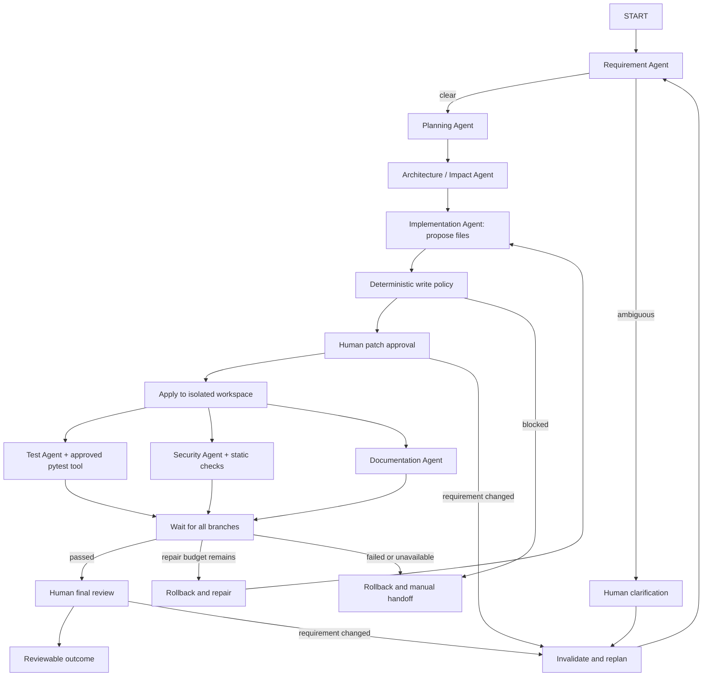

# Governed SDLC lifecycle

The assignment's critical differentiator is controlled, non-linear orchestration.
The original two-node workflow remains available for learning. The lifecycle graph
adds engineering proposals, approval, execution in an isolated copy, parallel
validation, recovery, and durable review artifacts. The current target stack is
Python/FastAPI/SQLite, replacing the original Java/PostgreSQL proposal.

## What the assignment expects, and what exists

| Expectation | Implementation / evidence | Limit |
| --- | --- | --- |
| Requirement understanding and ambiguity | Requirement role; clarification interrupt | Live reasoning quality not yet evaluated |
| Task decomposition and dependencies | Pydantic-validated plan with unique IDs and topological order | Proposed tasks are handled as one bounded change set, not a per-task scheduler |
| Brownfield reasoning | Bounded source snapshot passed to impact/implementation roles | Selected text files only; no AST symbol index or dependency resolver |
| Explicit stateful, non-linear workflow | `lifecycle/graph.py`, conditional edges and persistent state | Local single-user prototype |
| Sequential and parallel execution | Sequential analysis/proposal; test, security and documentation branches fan out | Implementation tasks themselves are not executed concurrently |
| Synchronization | `add_edge([tests, security, documentation], synchronize)` | All three results required |
| Shared context and lineage | Requirement revisions, baseline hash, plans, proposals, decisions, validation in SQLite checkpoints | Source snapshot is fixed for the run |
| Human checkpoints | Clarification, patch approval, final artifact review | Reviewer identity is self-declared, not authenticated |
| Controlled autonomy | No agent command tools; fixed pytest command; run-owned writes only | Approved tests execute local Python, not inside an OS security sandbox |
| Bounded retries | Two reasoning attempts; one repair; three requirement revisions | Retry policy is deliberately small |
| Fallback | `review_needed` outcome with evidence, no fabricated output | No secondary LLM provider fallback |
| Rollback | Restore isolated workspace to original snapshot on failure/rejection/stop/replan | No source, production data, or deployed-system rollback |
| Safe stop | STOP marker, node-boundary checks, test-process termination | In-flight LLM calls finish or time out; not instant cancellation |
| Guardrails | Path/type/size restrictions, credential pattern checks, migration immutability, approval hashes | Limited checks, not formal security/compliance assurance |
| Auditability | Ordered SQLite journal with output/approval hashes, revisions and hash chain | Not externally anchored; local administrator can rewrite/truncate the journal |
| Reliability metrics | Retry/rollback/failure counts, elapsed time, active-stage duration, success rate, MTTR | Local descriptive metrics; no SLO backend |
| Replanning | Revise at a human gate → rollback → invalidate downstream outputs/approvals → restart analysis | No automatic detection of concurrent source edits |
| Reviewable engineering outcome | Actual file proposal, unified diff, tests, security findings, documentation, final summary | No automatic merge, commit, deployment, or release |
| Three scenarios | Greenfield, brownfield and ambiguous offline fixtures, plus failure/repair/retry cases | Fixtures exercise a helper; real service scenarios remain to be validated |

## Workflow



Stop/reject routes also restore the baseline and terminate. Diagram omits those
repeated edges for readability; `graph.py` is the executable source of truth.

## Roles versus controls

`agents.py` contains structured contracts/prompts for all seven reasoning roles.
`ReasoningAgents` uses the existing provider-neutral `StructuredLLM` boundary.
`DemoAgents` returns clearly labeled scripted responses without creating an LLM
client. Demo input text is recorded but does not drive genuine model reasoning.

`graph.py` owns routing, synchronization, retry budgets, approvals, repair, stop,
and terminal outcomes. `tools.py` performs bounded snapshot/diff/workspace/test
actions. `runner.py` owns runs, checkpoint connections and command serialization.
`audit.py` records events and derives metrics. None of these controls is an LLM
agent. The same graph runs in demo and live modes.

Each node returns a partial update to shared state. Parallel branches write
different keys. The list-form join edge waits for all branches before assessing
the combined outcome. A schema-valid response is still a proposal, not proof of
semantic correctness. Acceptance coverage receives agent review and final human
review; tests and static checks add evidence but do not prove all behavior.

## Run without API costs

From `agent-orchestrator/`, with the virtual environment active:

```bash
python -m pip install -e ".[dev,ui]"
python -m streamlit run app.py --server.address 127.0.0.1 --browser.gatherUsageStats false
```

Open the root URL, http://localhost:8501. The former APP/Lifecycle navigation has
been consolidated into one screen. Leave mode set to **demo**. Choose a scenario,
start a run, review analysis/plan/impact/policy, select the current revision to
reveal its diff, then provide your name and a
review note. Patch approval and permission to run Python tests are separate. Check
the execution box only after reviewing the code. Successful validation leads to
a second, final review gate. Completed means a reviewed local artifact, not a
deployment. Download the diff or inspect the run artifacts.

Mode and decision selectors update the screen immediately without invoking the
graph. Demo shows only fixture scenarios; Live shows the requirement, source,
test interpreter and provider consent. Choose **Approve — looks correct** to
continue an acceptable proposal. Choose **Revise — change the requirement** to
show the new-requirement field and trigger replanning on submission. Clarification,
rejection and stopping have separate labels and consequences. The current diff is
available for review independently of the decision; it is never necessary to
choose Revise merely to inspect the proposed code.

CLI equivalent:

```bash
python -m agent_orchestrator.lifecycle.cli start "Validate HTTP/HTTPS destinations" --scenario greenfield
python -m agent_orchestrator.lifecycle.cli list
python -m agent_orchestrator.lifecycle.cli show RUN_ID
python -m agent_orchestrator.lifecycle.cli resume RUN_ID --action approve --actor "Your name" --note "Reviewed patch and test code" --digest DIGEST_FROM_PENDING --execute-tests
```

The run now pauses at final review if validation passes. Inspect `show RUN_ID` and
approve using the **new release digest**. Approval hashes include the requirement
revision, baseline, plan, impact, proposal, policy and test interpreter. Final
review additionally binds validation/documentation. A stale approval is rejected.

Other human decisions:

```bash
python -m agent_orchestrator.lifecycle.cli resume RUN_ID --action clarify --actor "Your name" --note "Reject destinations without an explicit scheme"
python -m agent_orchestrator.lifecycle.cli resume RUN_ID --action revise --actor "Your name" --note "Scope changed" --requirement "Updated requirement"
python -m agent_orchestrator.lifecycle.cli resume RUN_ID --action reject --actor "Your name" --note "Needs redesign"
python -m agent_orchestrator.lifecycle.cli stop RUN_ID
python -m agent_orchestrator.lifecycle.cli metrics
```

`sdlc` is the installed alias for `python -m agent_orchestrator.lifecycle.cli`.
Use `--runs-dir PATH` before the subcommand for a separate local run collection.
The CLI remains available to request stop while the Streamlit session is busy.

## Offline scenarios and expected transitions

| Scenario | Expected behavior |
| --- | --- |
| `greenfield` | Empty fixture → proposal → approval → actual passing pytest → final review |
| `brownfield` | Broken demo URL helper snapshot → fix proposal → review/validation |
| `ambiguous` | Human clarification required before planning; answer creates a new revision |
| `repair` | First fixture implementation fails actual tests → rollback → replacement proposal needs new approval |
| `failure` | Both implementation attempts fail actual tests → rollback → manual handoff |
| `retry` | Scripted transient planning failure → bounded retry → ordinary approval |

All fixtures operate only on generated run workspaces. They do not touch the URL
shortener service being built in the other chat. The demo helper is deliberately
small and is not offered as the service's production URL validation policy.

## Connecting the real service later

After service development is complete, install its test dependencies in its own
virtual environment. Then explicitly select live mode and its interpreter:

```bash
python -m agent_orchestrator.lifecycle.cli start "Your brownfield change" --mode live --source ../url-shortener --test-python ../url-shortener/.venv/bin/python
```

On Windows use the service environment's `Scripts/python.exe`. The existing
orchestrator `.env` supplies provider configuration. Live mode sends the bounded
source snapshot to that provider and incurs API charges. No live calls were
needed to validate the controller. Source changes made after snapshot creation
are not included: start a new run when you need a fresh baseline. Review the diff
against the current source before any manual application.

The interpreter is chosen by the human, persisted in state and bound into patch
approval. The fixed tool invokes pytest with plugin autoload disabled, a temporary
HOME, no inherited API keys, a 30-second timeout, and an output-size bound. Service
tests requiring plugins must be supported deliberately in a later tool-policy
change. No dependency installation is performed by agents. Pytest output is not
sent to the model; only result metadata is recorded. This protects against leaking
raw log contents but limits automated diagnosis detail in this iteration.

## Persistence, artifacts, recovery and metrics

Runs live in ignored `agent-orchestrator/.runs/RUN_ID/`:

- `metadata.json`: run mode and source identity.
- `checkpoints.sqlite`: graph state and pending human interrupts, including historical state.
- `audit.sqlite`: event order, stage timings, output hashes, human decisions and recovery actions.
- `workspace/`: run-owned copy, restored to baseline on rollback.
- `proposal.diff`: latest proposal; `proposals/HASH.diff` retains previous proposals.
- `outcome.md`: final status and handoff summary.
- `RUNNING`: exclusive command lock while executing; `STOP`: cooperative cancellation flag.

Pause/resume survives process restarts at human gates. Treat this directory as
private: checkpoints contain source, requirements and decision notes. Credential
checks are limited patterns; review your source before sending it to any provider.
Hidden files, symlinks, virtual environments, databases and caches are not copied.
Snapshot limits are 100 text files, 200 KB total, 50 KB per file. Exceeding these
limits stops snapshot creation rather than silently truncating source context.

Crash recovery is limited: a killed process can leave a RUNNING marker. Confirm
the process and its test children have stopped before manually removing that
run-owned marker. Use `show` to inspect the checkpoint. A run paused at a human
gate can resume normally. For a crash mid-action, preserve artifacts and start a
fresh run; arbitrary crash replay is not yet a supported operator command. Applying
a proposal is idempotent, but local filesystem effects and SQLite checkpoints are
not one atomic transaction. No rollback of a real service database is attempted.

Metrics definitions:

- Elapsed time: first to latest audit event, including human waiting between events.
- Active-stage seconds: sum of recorded reasoning/test durations; parallel durations
  overlap, so this is work time rather than wall-clock execution latency.
- Success rate: completed runs divided by terminal runs. Rejected, stopped and
  review-needed runs are non-success outcomes; paused runs are excluded.
- Retries: actual repeated reasoning attempts and repair cycles.
- Rollbacks: baseline-restoration controller invocations, including replanning.
- MTTR: time from the first unresolved failure to a later completed event in that
  run, including human waiting. Null means no observed recovery, not zero seconds.

The journal hash chain detects edited entries but not a privileged rewrite of the
entire chain or truncation. Authenticated approval identities, externally anchored
audit logs, container/OS execution isolation, broader policy scanning, and service
integration remain work before calling this a production control plane.

## Verification

```bash
python -m pytest -q
python -m pip check
```

`test_lifecycle.py` uses the actual LangGraph runtime, SQLite checkpoints and real
pytest subprocesses. A threading barrier proves that the three validation branches
execute concurrently. Other tests cover restart/resume, failed validation and
repair, exhausted budgets, missing execution permission, path restrictions,
stopping, rollback, requirement revision and stale approvals. Additional tests
cover read-only source handling, release integrity, event tampering and the UI.

## Source references

- [LangGraph interrupts](https://docs.langchain.com/oss/python/langgraph/interrupts)
- [LangGraph persistence](https://docs.langchain.com/oss/python/langgraph/persistence)
- [Graph API and synchronization](https://docs.langchain.com/oss/python/langgraph/graph-api)
