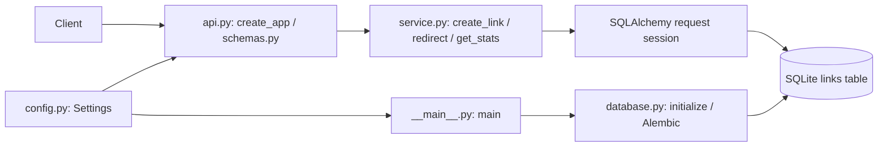

# Service architecture

All package files are in `url-shortener/src/shortener/`. `errors.ServiceError` and
handlers in `api.create_app` translate failures to the documented envelope.
No external service or destination requests occur.

- Create: `schemas.CreateURL` validates/normalizes inputs. `service.create_link`
  obtains the injected clock once, rejects nonfuture expiration, inserts and commits.
  `Link.code` primary key enforces uniqueness. Integrity failures roll back; a
  lookup distinguishes collisions from unrelated failures. Custom conflict is 409;
  random collisions retry up to `MAX_ATTEMPTS=5`, then 503.
- Redirect: `service.redirect` captures request time, executes conditional
  `UPDATE ... SET clicks=clicks+1 ... RETURNING destination` for an unexpired code,
  commits, then route `follow` sends 302/no-store. No match rolls back and checks
  existence to distinguish 404 from 410. Expiration is evaluated at this operation's
  captured time, even if the DB subsequently waits on a lock.
- Expiration: schema requires timezone awareness; `models.UTCInstant` stores
  fixed-width `YYYY-MM-DDTHH:MM:SS.ffffffZ` text (27 characters). UTC lexicographic
  comparisons match time order. Null never expires; equality expires. The clock
  defaults to `service.utc_now` and can be injected into `api.create_app`.
- Stats: `service.get_stats` reads the row without increment or expiration rejection.
  No visitor-level data is collected. See README for delivery/counting limitations.

## Storage and lifecycle

Migration `migrations/versions/0001_links.py` creates `links`:

| Column | Storage / constraint |
| --- | --- |
| code | VARCHAR(32), primary key, case-sensitive SQLite BINARY comparison |
| destination | TEXT, not null |
| created_at | VARCHAR(27), not null, UTC text |
| expires_at | VARCHAR(27), nullable, UTC text |
| clicks | INTEGER, not null, CHECK clicks >= 0; application initializes 0 |

The primary key's SQLite index is sufficient for point lookups/updates. No additional
indexes or expiration cleanup are needed. SQLite does not enforce VARCHAR lengths;
API validation enforces them. Alembic also stores its revision in `alembic_version`.

`config.Settings` resolves paths relative to the checkout service root and validates
the configured public origin. CLI `init-db` creates directories and applies head
via a supplied SQLAlchemy connection. CLI `serve` and application lifespan check
readiness. Neither uses `create_all`. A missing file is checked before connecting,
so ordinary startup does not create an empty database. `/health` repeats readiness
checks; it proves readable schema, not write access or disk capacity.

`database.make_engine` uses built-in sqlite3, NullPool, cross-thread-enabled connections
and a configurable bounded busy timeout (default 5 seconds). Every request owns a
Session with rollback in finally and close on exit. Writes commit promptly; failures
roll back. Read sessions end with rollback. SQLite default rollback journal is used,
not WAL. No automatic retries for busy databases; 503 asks clients to retry.
No automatic schema upgrades, reset, cleanup or data deletion occur at startup.

## Change impact

| Change | Start here | Also inspect |
| --- | --- | --- |
| Alias restrictions | `schemas.py: Alias, RESERVED` | `service.create_link`, conflict tests, README |
| Expiration | `schemas.CreateURL`, `service.redirect` | `UTCInstant`, boundary tests; migration if representation changes |
| Redirect status/HEAD | `api.py: follow` within `create_app` | README, OpenAPI, redirect tests |
| Validation/error shape | `schemas.py`, API exception handlers | error models, validation tests, API clients |
| Analytics | `service.redirect/get_stats`, `models.Link` | migration, concurrency/failure tests, privacy docs |
| Storage | `database.py`, `models.py`, migration versions | config, CLI, backup runbook, persistence tests |

SQLite minimizes setup and keeps the service portable. It serializes writes,
including every redirect, and is unsuitable for distributed high-write traffic.
There is no authentication, abuse prevention or rate limiting. Public analytics,
enumerable codes and sensitive destination query strings are remaining risks.

## Bundled browser UI

`api.create_app` serves `web/index.html` at `/`, and explicit `/api/ui/app.css` and
`/api/ui/app.js` routes serve packaged assets. No additional alias is reserved,
because `api` was already reserved. The routes are omitted from OpenAPI; API routes
and database schema remain unchanged. No additional process, dependency or build step.

`web/app.js` calls the existing create/stats APIs, converts local datetime input to
UTC, and renders responses with textContent. It does not fetch destinations or
persist data in browser storage. Stats are manually refreshed; the displayed status
badge uses the browser clock at lookup time. Creation and lookup buttons show pending
state. Errors preserve API status/messages; clipboard failure has a manual fallback.
A same-origin CSP disallows inline scripts and framing. Page assets are served with
no-store, nosniff and no-referrer headers. These controls do not add authentication.
